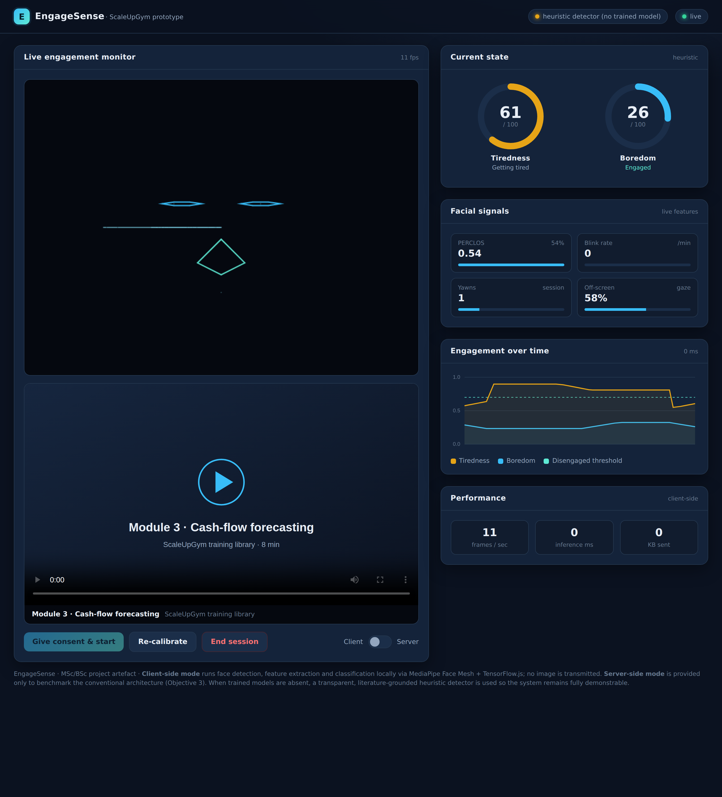

# EngageSense — Real-Time Tiredness & Boredom Detection for E-Learning

The working artefact for *Real-Time Facial Expression Analysis for Detecting
Tiredness and Boredom in E-Learning Environments* (Junaid Khan, 4329505;
supervisor Dr Ali Salimian, LSBU).

A learner watches a training video while EngageSense analyses their facial
expression **entirely in the browser** and reports tiredness and boredom in real
time — with a live dashboard, session analytics, and a client-vs-server
deployment toggle that is the project's distinctive contribution.



## What it does

- **Live detection** of tiredness and boredom from a webcam, at ~10 fps.
- **Face-mesh overlay** with live blink / yawn / disengagement badges.
- **Per-person calibration** — a 5-second baseline captures the user's alert
  resting state so scores are relative to the individual (Ch 2.6).
- **Facial-signal panel** — PERCLOS, blink rate, yawn count, off-screen gaze.
- **Engagement-over-time chart** with the disengagement threshold marked.
- **Two deployment modes** — client-side (all local, no image transmitted) and a
  server-side baseline — switchable live, with a performance panel (fps, inference
  latency, bytes sent) so the two can be compared (Objective 3).
- **Session summary** with aggregate analytics and **CSV export** of derived
  measurements (never images) for the Chapter 5 evaluation study.
- **Gentle intervention** — a break prompt appears only on sustained disengagement.

## Runs today, upgrades later

The artefact ships with a **transparent heuristic detector** grounded in the
drowsiness/boredom literature (PERCLOS, EAR, MAR, gaze, head pose). This means it
is **fully demonstrable before the deep models are trained**, and the heuristic
doubles as an interpretable baseline the trained models are measured against.

When you train the LSTM (tiredness) and MobileNetV2-fusion (boredom) models and
convert them to TensorFlow.js into `app/models/`, the app loads them automatically
and switches from "heuristic" to "trained" (shown in the top-right pill).

## Quick start (client-side — the main artefact)

A webcam needs a secure origin, so serve over `localhost`:

```bash
cd app
python -m http.server 5500
# open http://localhost:5500  →  "Give consent & start"
```

That's it — no build step, no install. The three CDN libraries (MediaPipe Face
Mesh, MediaPipe Camera Utils, TensorFlow.js) load from jsDelivr; an internet
connection is needed the first time.

## Server-side mode (comparison baseline)

```bash
cd server
pip install -r requirements.txt
uvicorn app:app --host 0.0.0.0 --port 8000
```

Then tick the **Server** toggle in the UI. Frames are downscaled and POSTed to the
server, which runs the identical pipeline and returns scores — letting you measure
the bandwidth / latency / load cost of the conventional architecture. Only derived
numbers are ever stored (SQLite); images are never written to disk.

## How it maps to the dissertation

| Section | Where |
|---|---|
| 3.4 Feature extraction | `app/js/features.js` (mirrors `server/src/features/`) |
| 3.5 Two configurations | client = `app/`, server = `server/` |
| 3.6 / 4.5 Models | `server/src/models/` + `app/models/` (TF.js) |
| 4.3 No-face = disengagement | handled in `features.js` / `engine.js` |
| 4.6 Client-side deployment | `app/js/engine.js`, `detector.js` |
| 4.7 Server-side deployment | `server/app.py` |
| 4.8 Privacy-by-design | client keeps images local; server stores only derived numbers |
| 3.7 Evaluation | performance panel + CSV export + `server/scripts` (in full repo) |

## Honesty notes for the write-up

- The **heuristic detector is real computer vision** (validated geometric
  features + literature-grounded thresholds), not a trained deep model. Describe
  it as an interpretable baseline, and report trained-model results against it.
- **Thresholds** (`TH` in `features.js`) are starting values — tune them on your
  data and report how.
- Head pose in the browser uses a lightweight geometric **proxy**, not `solvePnP`
  as on the server; note this as a minor client/server discrepancy.
- The bundled lesson video and poster are placeholders — swap in a real ScaleUpGym
  clip for the demo.

## Files

```
app/            the browser artefact (open app/index.html via a local server)
  index.html    dashboard
  css/styles.css
  js/           features · detector · engine · overlay · chart · ui
  models/       drop trained TF.js models here (optional)
  assets/       placeholder lesson video + poster
server/         FastAPI server-side baseline + full training pipeline (src/)
docs/           screenshots
```
